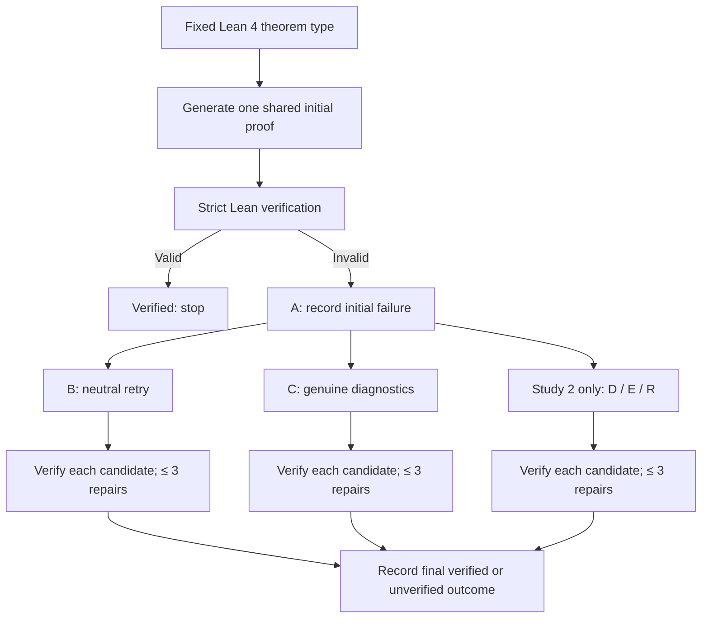
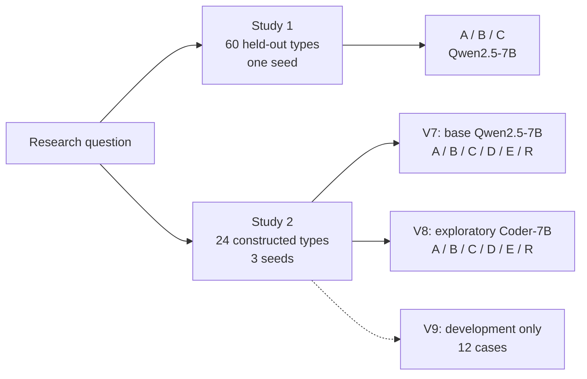

# Compiler Feedback Versus Retry Controls in Lean 4 Proof Repair

### Two local-model studies · Research code, frozen evidence, and manuscript companion

[**Read the results**](#results-at-a-glance) · [**Study protocol**](#experimental-design) · [**Find the evidence**](#manuscript-to-evidence-map) · [**Reproduce the analyses**](#reproducibility-and-verification) · [**Limitations**](#interpretation-and-limitations)

> **Scientific status (November 2026).** This repository supports *Compiler Feedback Versus Retry Controls in Lean 4 Proof Repair: Two Local-Model Studies* by Faraz Masood and Sadia Peerzada. It contains two **separately constructed** studies of proof synthesis for **fixed Lean theorem statements**, not natural-language-to-Lean translation. **Neither study establishes a feedback-specific advantage or equivalence** between guided repair and retry controls. Study 1 has two unavailable guided outcomes. Study 2 has a small, partly overlapping constructed theorem cohort and exploratory analyses. The evidence archive has qualified provenance and privacy limits; an indexed ZIP is **not** proof of independent experimental replay.
>
> **Non-destructive documentation update.** This landing page and its companion guides describe existing frozen records. They do not replace, rerun, fabricate, or retrospectively modify experiments. Historical documents and manuscript snapshots elsewhere in the repository may describe *earlier stages of the project* and must not be mistaken for the current two-study manuscript.

## Start here

| For readers who want to… | Recommended starting point |
|---|---|
| Understand the research question and findings | [Results at a glance](#results-at-a-glance), then [Interpretation](#interpretation-and-limitations) |
| Find every item in the manuscript's Table 10 | [Manuscript evidence index](docs/MANUSCRIPT_EVIDENCE_INDEX.md) |
| Understand which directories are current versus historical | [Repository and archival guide](docs/REPOSITORY_GUIDE.md) |
| See the full protocol and evidence provenance diagrams | [Protocol and evidence diagrams](docs/RESEARCH_DIAGRAMS.md) |
| Read the frozen Study 2 base-model report | [V7 test report](research/study2-v7/test/REPORT.md) |
| Inspect paired contrasts, coverage and cost | [Post-hoc analysis findings](analysis/taimma_20261104/FINDINGS.md) |
| Inspect control-integrity and Lean-overlap checks | [Professor validation evidence](analysis/taimma_final_professor_validation/README.md) |
| Inspect privacy / provenance limitations | [Reproducibility scope](analysis/taimma_final_professor_validation/REPRODUCIBILITY_FINAL_VERIFICATION.md) and [archive warnings](research/study2-raw-v8-v9/PRIVACY_SCAN_WARNINGS.json) |
| Check Table 10 paths without inference | Run `python3 scripts/check_manuscript_evidence.py` at the repository root |

## Research question

Does feeding a model **the genuine diagnostics returned by Lean after a failed proof** improve strictly verified whole-proof repair compared with retrying without those diagnostics, once retry opportunities and other explanations are considered?

The experimental unit is a **fixed formal theorem type** and a generated **proof candidate**. Lean checks the candidate against that type. A proof that merely changes wording, changes its compiler error, or compiles only after weakening the original statement is **not** a verified success.

The two studies deliberately **must not be pooled**. They differ in their theorem cohorts, output-token limits, model runs, and available controls. The base-model follow-up is not a replication on the original 60 theorem types.

### Scope in one minute

- **Study 1:** 60 held-out theorem types, one seed, Qwen2.5-7B-Instruct-4bit. Conditions A (initial only), B (neutral/blind retry), C (matched compiler diagnostics); up to three repair attempts for B and C.
- **Study 2 / V7:** 24 independently constructed *from Study 1* theorem types, eight author-assigned families, seeds 2027–2029 (72 correlated theorem–seed evaluations), Qwen2.5-7B-Instruct-4bit. Conditions A/B/C plus D (shuffled diagnostics), E (approximately token-matched neutral text) and R (independent resampling).
- **Study 2 / V8:** The same 24-type cohort and three seeds with exploratory Qwen2.5-Coder-7B-Instruct-4bit evaluation. Not a new dataset or a confirmatory replication.
- **V9:** 12 **development-only** Coder-model cases comparing an error-aware strategy with guided repair. Not a held-out test and not evidence of additional V8 test success.
- **Verifier:** Lean 4.32.0 with pinned Mathlib, exact target type and restricted approved axioms. No `sorry`, `admit`, unauthorized declarations or altered target statements as successes.
- **Research outcome:** Policy-level differences are descriptive and statistically inconclusive; they do not identify a causal benefit from correctly matched diagnostic content.

## Results at a glance

### Study 1 — original 60-type pilot

| Arm | Strictly verified | Missing outcomes | Interpretation |
|---|---:|---:|---|
| A — initial generation | 0/60 | 0 | No initial solutions |
| B — neutral retry | 1/60 | 0 | One solved theorem |
| C — genuine compiler diagnostics | **1/58 observed** | **2** | Same solved theorem as B |

On the **58 complete B/C pairs**, both arms solve the same one theorem; there are **zero discordant verified successes**. The exact McNemar p-value is 1.0, which **does not** establish equivalence. The missing C cases are not silently counted as failures: one exceeded the context preflight and one ended in an interrupted stream of unknown cause. The manuscript's full-cohort C–B missingness identification bound is **[0, +3.33] percentage points** (not a confidence interval). C used approximately **2.2× B's input tokens per complete theorem**.

### Study 2 — 24 types × 3 seeds = 72 dependent evaluations *per model*

Each numerical entry below is the number of **verified theorem–seed evaluations**, *not* independent theorem types. A/B/C/D/E/R are separate policies that share initial candidates within each theorem–seed evaluation.

| Arm | Policy | V7: Qwen2.5-7B | V7: rescued after initial failure | V8: Coder-7B | V8: rescued after initial failure |
|---|---|---:|---:|---:|---:|
| **A** | Initial generation only | 4/72 | — | 11/72 | — |
| **B** | Neutral retry | 5/72 | 1 | 11/72 | 0 |
| **C** | Matched compiler diagnostics | **10/72** | **6** | 11/72 | 0 |
| **D** | Shuffled, different-family diagnostics | 9/72 | 5 | 11/72 | 0 |
| **E** | Approximately token-matched neutral retry | 5/72 | 1 | 11/72 | 0 |
| **R** | Independent resampling without predecessor | 5/72 | 1 | **14/72** | **3** |

V7 C achieves the largest **evaluation count**, but D nearly matches it despite using unrelated (not necessarily semantically inert) compiler errors. In V8, B–E **do not rescue any failed initial proofs**; only R adds three verified evaluations. Do not interpret V8's 11/72 guided total as 11 guided *repairs*.

### Aggregate count is not theorem coverage

| V7 arm | Verified evaluations / 72 | Distinct theorem types solved / 24 | Families represented / 8 |
|---|---:|---:|---:|
| A | 4 | 2 | 1 |
| B | 5 | 3 | 2 |
| C | **10** | **4** | 3 |
| D | 9 | **7** | **4** |
| E | 5 | 3 | 2 |
| R | 5 | 2 | 1 |

The count totals and distinct-type coverage are **different endpoints**. Three successes on the same theorem across seeds count as three verified evaluations, but one distinct solved type. See the frozen [V7 outcomes](research/study2-v7/test/outcomes.csv), [theorem-coverage table](analysis/taimma_20261104/results/V7_theorems.md) and [paired table](analysis/taimma_20261104/results/V7_paired.md).

### Paired uncertainty (V7, descriptive post-hoc analysis)

| Contrast | Observed difference in verified evaluations | Theorem-cluster 95% interval | Reading |
|---|---:|---|---|
| Matched C − neutral B | **+6.94 percentage points** | [−1.39, +18.06] | Interval includes zero |
| Matched C − shuffled D | **+1.39 percentage points** | [−5.56, +9.72] | Interval includes zero |

The theorem-cluster bootstrap resamples **24 theorem types**, preserving their repeated seeds, rather than treating all 72 rows as independent. Family-cluster sensitivities also include zero. C–B was named in the V7 plan; C–D and these reported uncertainty analyses are **post hoc**. Neither superiority nor equivalence is established. See [paired results](analysis/taimma_20261104/results/V7_paired.md) and [full structured analysis](analysis/taimma_20261104/results/results.json).

### Repair-only input-token cost (V7)

| Arm | Repair calls | Repair input tokens | Repair output tokens |
|---|---:|---:|---:|
| B | 203 | 40,492 | 17,312 |
| C | 197 | **53,838** | 14,256 |
| D | 200 | 56,277 | 15,744 |
| E | 204 | 56,111 | 16,924 |
| R | 202 | 29,792 | 21,121 |

The shared initial-generation tokens (**9,501 input / 4,701 output**) are counted separately; these are **repair-only** totals. Compared with B, C uses approximately **33% more input tokens**. Equal maximum retry allowances are **not** equal realized compute or tokens. See [V7 costs](analysis/taimma_20261104/results/V7_costs.md). Counts and costs must not be combined across the two studies.

## Experimental design

### 1. Bounded whole-proof repair



**Interpretation:** Repair arms begin from the **same initial proof within an evaluation**, not from identical later trajectories. Each repair arm can then change its candidate and subsequent input context independently. The original theorem statement stays fixed.

### 2. Which controls answer which question?

| Arm | What the model sees after initial failure | What this does **not** isolate |
|---|---|---|
| A | Nothing; stop after initial check | No repair opportunity |
| B | Previous candidate plus neutral retry instruction | Maximum calls matched to C, **not** total tokens |
| C | Previous candidate plus genuine preceding Lean diagnostics | Diagnostic content is mixed with evolving candidate history |
| D | Different-family diagnostics selected by a fixed hash rule | Not category-matched or semantics-free; may contain generic syntax clues |
| E | Neutral padding approximating C-format input length | First-repair prompt length is closely matched, not full compute or later trajectories |
| R | Fresh generation without showing failed predecessor | Changes predecessor display and sampling as well as the input context |

**Frozen primary comparison in V7:** C vs B. **Post-hoc interpretive comparison:** C vs D. All B–E repair policies allow at most three repairs; A allows zero. This is a comparison of **repair policies**, not an experiment that isolates pure diagnostic semantics. See the manuscript's Table 3 and [protocol guide](research/study2-v7/README.md).

### 3. Two distinct research streams



Do **not** interpret 60 + 72 + 72 as an independent combined sample. Within Study 2, seeds reuse the same theorem types; formal relationships also occur among some constructed types and between development and test items.

### 4. Model and verifier configuration

| Item | Study 1 | Study 2 |
|---|---|---|
| Lean / Mathlib | Lean 4.32.0 / pinned Mathlib | Lean 4.32.0 / Mathlib commit `81a5d257` |
| Base model | Qwen2.5-7B-Instruct-4bit (local MLX) | Qwen2.5-7B-Instruct-4bit (V7); Coder-7B-Instruct-4bit (V8) |
| Initial temperature | 0.2 | 0.2 |
| Context window | 8,192 tokens | 8,192 tokens |
| Output-token allowance | 2,000 | 1,200 |
| Test seed(s) | 2027 | 2027, 2028, 2029 |
| Repair budget | Maximum 3 per repair arm | Maximum 3 per repair arm |
| Environment | Fixed type, strict standard-axiom acceptance | Restricted fixed imports including Nat.Basic, Ring, Tauto |
| Status | Frozen pilot; two C outcomes missing | V7 frozen comparison; V8 exploratory; V9 dev only |

The model weights and hardware/runtime caches are **not distributed** in this repository. Exact environment identity and archive verification are documented in the evidence files, not established by this summary table alone.

## Manuscript-to-evidence map

The companion manuscript's **Table 10** lists six sources. **All six paths existed on the public default branch when this documentation update was prepared.** Click through each entry below, or use the [expanded evidence index](docs/MANUSCRIPT_EVIDENCE_INDEX.md) for scope, representative files, expected interpretation and limitations.

| Table 10 evidence | Path | What to inspect |
|---|---|---|
| V7 frozen outcomes | [research/study2-v7/test/outcomes.csv](research/study2-v7/test/outcomes.csv) | Theorem–seed outcomes for V7 |
| V7 protocol | [research/study2-v7/test/plan.json](research/study2-v7/test/plan.json) | Frozen arm definitions and run metadata |
| V8/V9 archive journals | [research/study2-raw-v8-v9/](research/study2-raw-v8-v9/) | Indexed ZIP, hashes and developer-only separation |
| Paired post-hoc analysis | [analysis/taimma_20261104/](analysis/taimma_20261104/) | Paired contrasts, uncertainty, theorem coverage and cost |
| Scientific integrity audit | [analysis/taimma_supervisor_final/](analysis/taimma_supervisor_final/) | Cases, token/context analysis and provenance qualifications |
| Lean overlap certificates | [analysis/taimma_final_professor_validation/](analysis/taimma_final_professor_validation/) | Scoped mathematical certificates and control-integrity checks |

Other significant artifacts are [publication/](publication/) (historical release bundle and Study 1 redacted public views), [research/study2-v7/test/summary.json](research/study2-v7/test/summary.json), and the [Study 2 analysis README](analysis/taimma_20261104/README.md). Archived reports, older LaTeX manuscripts and earlier planning documents may be historically correct for their own snapshots while **not** describing the present manuscript.

### Research integrity and snapshot boundaries

- Study 1 / V7 / V8 / V9 evidence was preserved in reviewed research snapshots. The manuscript references an earlier evidence commit `a3a709c383ce` and a later supplemental-validation commit `aae97d197f63`. **Do not attribute later certificates to the earlier snapshot.**
- The V8/V9 archive's indexed records and the 40 historical lock entries have been checked in their **documented historical scope**. Hash consistency does not prove an inference was independently rerun.
- V7 public trajectories include **sanitized derivatives of untracked original records**; original-byte historical provenance is weaker than the indexed V8 journal. The committed derivative enables certain descriptive analyses, not universal replay.
- The audit records **1,220 local-path warning records**, whose occurrence counts sum to **22,882**. **Manual privacy and license review remains required.** An automated scan is not a publication-clearance certificate.
- Benchmarks have AI-assisted review and identified overlapping formal statements. Strict Lean certificates establish specific formal relationships, **not** benchmark independence, English-semantics fidelity or independent human review.

## Reproducibility and verification

### 1. Clone the actual research repository

```bash
git clone https://github.com/sadiapeerzada/Compiler-Guided-Proof-Repair-in-Lean-4.git
cd Compiler-Guided-Proof-Repair-in-Lean-4
git rev-parse HEAD
git status --short
```

Use the cited commit/ref when reproducing a historical reported artifact. This repository was renamed; old frozen plans and documents may retain the former repository name for provenance. Do **not** rewrite frozen references just to make everything look uniform.

### 2. Verify the manuscript's Table 10 references (no model or Lean required)

```bash
python3 scripts/check_manuscript_evidence.py
```

This new checker performs **read-only path-presence checks** for the six cited paths and a small set of supporting navigation targets. A passing result means these *paths exist in the checkout*—**not** that the underlying statistical claims, proof certificates, privacy, exact hashes or full inference have been independently verified.

### 3. Re-run the published post-hoc statistical analysis (no inference)

```bash
python3 analysis/taimma_20261104/analyze.py
python3 -m unittest discover -s tests -p test_taimma_evidence.py
```

These commands come from the [analysis guide](analysis/taimma_20261104/README.md). Review that guide and use a disposable working copy if recomputation would update derived report files. Do not overwrite frozen data or confuse post-hoc resampling with a fresh model experiment.

### 4. Verify archive integrity (not inference replay)

The [V8/V9 archive README](research/study2-raw-v8-v9/README.md) documents its own package-hash and indexed-member verifier:

```bash
python3 research/study2-raw-v8-v9/study2_publish_v8_v9.py verify --packet research/study2-raw-v8-v9
```

This checks archive bytes against committed manifest metadata; it does not regenerate model replies. The archive's [privacy warnings](research/study2-raw-v8-v9/PRIVACY_SCAN_WARNINGS.json) remain unresolved pending manual review.

### 5. Inspect independent scope qualifications

For check commands and exact limits, consult [professor validation](analysis/taimma_final_professor_validation/README.md), [read-only audit](analysis/taimma_final_professor_validation/REPRODUCIBILITY_FINAL_VERIFICATION.md), [supervisor supplement](analysis/taimma_supervisor_final/README.md), and [Study 1's historical public reanalysis](publication/README.md). Distinguish (a) re-analysis of published summaries, (b) SHA-256 archive checks, (c) scoped Lean relationship certificates, (d) replay of exact original candidates, and (e) fresh model inference. These are **not interchangeable**.

## Repository layout and historical materials

```text
.
├── README.md                           # Current paper-facing landing page
├── docs/
│   ├── MANUSCRIPT_EVIDENCE_INDEX.md    # Paper Table 10, direct artifact guide
│   ├── REPOSITORY_GUIDE.md             # Current vs historical paths; safe cleanup
│   └── RESEARCH_DIAGRAMS.md            # Editable protocol/provenance diagrams
├── research/
│   ├── study2-v7/test/                # Base-model frozen protocol and outcomes
│   └── study2-raw-v8-v9/              # Coder archival evidence / dev-only V9
├── analysis/
│   ├── taimma_20261104/               # Statistical and overlap analyses
│   ├── taimma_supervisor_final/        # Case studies, integrity supplement
│   └── taimma_final_professor_validation/ # Certificate/control checks
├── publication/                       # Historical Study 1 public release
├── submission_20261103/               # Dated manuscript-source snapshot
├── paper/                              # Earlier paper material (historical)
├── data/                               # Legacy and frozen data; inspect scope
├── lean_project/                       # Lean toolchain, Mathlib and project
├── src/  eval/  prompts/  configs/     # Code, evaluation and protocol components
├── scripts/                            # Utility scripts; read-only path check
└── tests/                              # Existing tests
```

The repository retains some older pilot and pre-freeze documents. They are **not all current instructions**. Rather than deleting them or silently rewriting evidence history, [REPOSITORY_GUIDE.md](docs/REPOSITORY_GUIDE.md) labels their role and gives maintainers a safe review process. Root [RUN_REPORT.md](RUN_REPORT.md) is a historical hand-authored/partly simulated run and **must not** be presented as final-model verified success.

## Interpretation and limitations

1. **No feedback-specific causal effect established.** C–B controls maximum attempts but not later histories, input content, realized token budgets, order in Study 1 or sampling streams. D may supply useful generic syntax cues.
2. **Power and dependence.** Study 1 has a floor effect with one solved theorem; Study 2 has 24 nominal types reused across three seeds and eight overlapping/related families. The reported uncertainty includes zero and is not an equivalence test.
3. **Known construction overlap.** Some formal theorem statements are related across split boundaries or within test. Lean relationship certificates are scoped checks, not human adjudication, proof of benchmark independence or a remedy for leakage.
4. **Strict target verification is not English-to-Lean translation.** English annotations in Study 2 are placeholders; the task is to synthesize proof text for supplied fixed Lean types.
5. **Incomplete historical provenance.** V7 sanitized derivatives lack fully indexed original raw-call provenance; V8 archive byte-integrity checks are stronger but do not independently replay inference or full original Lean candidates.
6. **Computational cost matters.** Input and output tokens vary by policy, even with the same maximum retry allowance. Recorded timers include setup/journaling and cannot simply be summed into wall time.
7. **Research and publication rights remain bounded.** Automated screening is not full privacy, attribution, license or consent review; private original data/model weights are not implicitly released.

**Overall takeaway:** More verified theorem–seed evaluations under compiler-guided prompting do **not by themselves** establish that correctly matched compiler diagnostics caused the improvement. Report **verified success**, **distinct theorem coverage**, **rescued-after-initial successes**, **paired uncertainty**, and **token expenditure** separately.

## Authors, citation and reuse

**Research:** Faraz Masood and Sadia Peerzada · Aligarh Muslim University, Aligarh, India.

**Manuscript:** *Compiler Feedback Versus Retry Controls in Lean 4 Proof Repair: Two Local-Model Studies* (TAIMMA 2027 research submission/review version; do not infer acceptance or publication). The actual reviewed manuscript should be cited by its **verified version and venue status**; no DOI or acceptance is asserted here.

The repository is a combination of research code, original analyses, derived records, third-party-sourced mathematical material, archived snapshots and restricted/provenance-qualified evidence. **Do not assume a blanket license** for all directories. Consult the [third-party rights notice](publication/third_party/RIGHTS_AND_ATTRIBUTION.md) and provenance documentation before redistribution or external release. No model weights, private original trajectories, or independent semantic certification are represented as publicly provided.

---

*Documentation and navigation are maintained separately from frozen scientific records. For a specific manuscript result, follow its provenance link and exact historical commit; when a source and a summary disagree, preserve the original and report the discrepancy rather than silently editing data.*