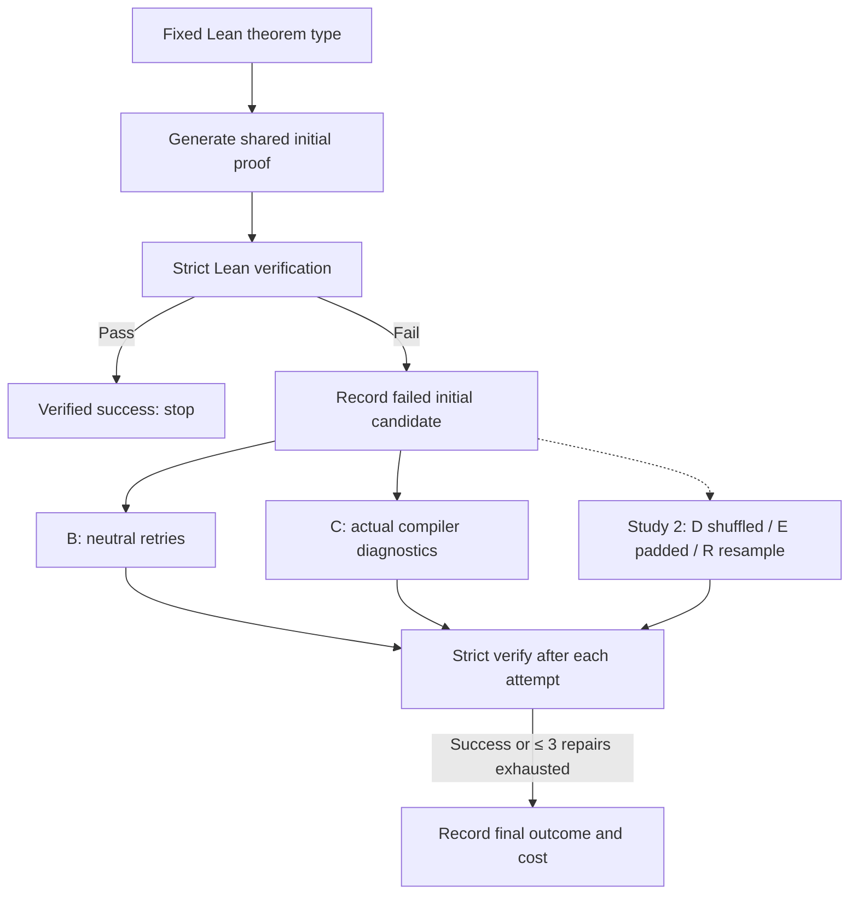
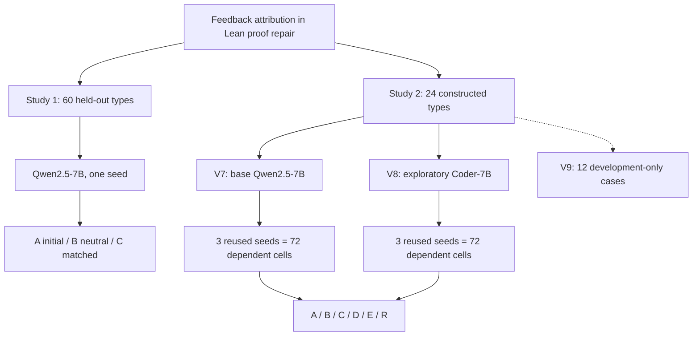
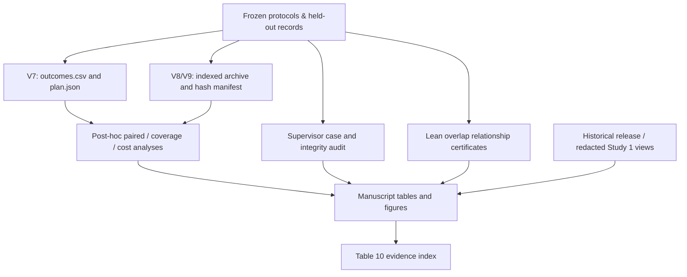
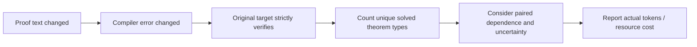

# Editable research diagrams

[Main README](../README.md) · [Evidence index](MANUSCRIPT_EVIDENCE_INDEX.md) · [Repository guide](REPOSITORY_GUIDE.md)

These **Mermaid source diagrams** render directly in GitHub Markdown, are editable without proprietary design files, and visualize **documented protocols and evidence relationships**. They are not a rerun, new analysis or reproduction of manuscript figure pixels.

## 1. Bounded fixed-statement proof repair

**Scope:** For Study 1 A simply stops after the initial verification and repair policy B/C is evaluated from the common failed candidate. Study 2 adds D/E/R and uses separate theorem types and model runs. Later histories diverge and the maximum retry count is not a total-token match.

## 2. Study / model / evaluation-unit map

**Not permitted:** Combining all rows into one independent-problem count. V7 and V8 reuse the same constructed theorems; Study 1 uses its own separate cohort.

## 3. Evidence provenance and what verification means

**Interpretation:** This is a documentation dependency map. A file path existing is not a hash check; a matching hash is not a regenerated response; a successful Lean certificate check is not full historical candidate replay; a formally related pair of statements is not proof of benchmark independence or human adjudication.

## 4. Interpretation hierarchy

The arrows are **questions to check**, not causal or logical implications. Text and errors can change without verified success. Verification counts do not automatically represent broad theorem coverage, significant improvement, or matching-compute efficiency.

## Source links

The diagrams summarize [Study 1 public release](../publication/README.md), [Study 2 protocol](../research/study2-v7/test/plan.json), [V7/V8 analyses](../analysis/taimma_20261104/FINDINGS.md) and the [final validation scope](../analysis/taimma_final_professor_validation/README.md). They are not substitutes for the manuscript's original Figures 1–3 or audit input files.

*For publication-quality vector art, render/redraw only the conceptual protocol in the manuscript's chosen visual style. Do not turn this conceptual map into experimental outcome evidence.*