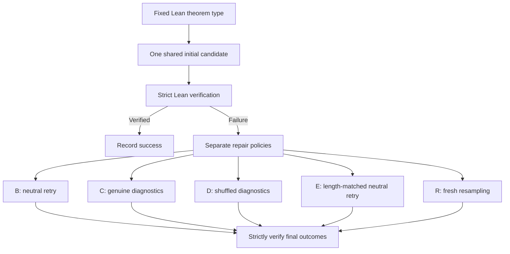
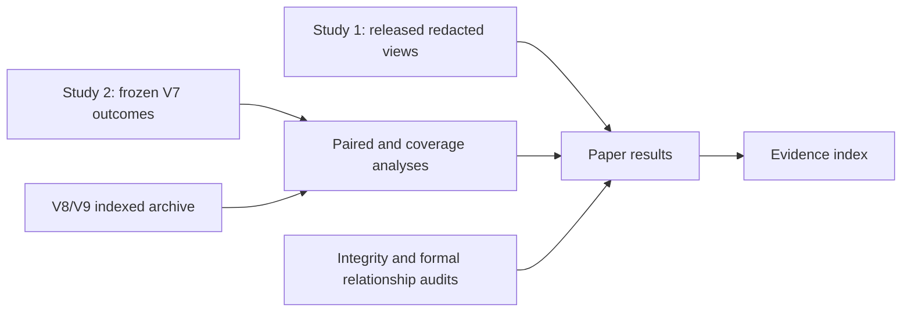

# Compiler Feedback Versus Retry Controls in Lean 4 Proof Repair

### Two local-model studies · Compact evidence companion

This is a **curated presentation and derived-results package**, not the complete experimental archive. It is designed to make the reported results easy to inspect without mixing them with historical development files. The complete research record remains at [the source repository](https://github.com/sadiapeerzada/Compiler-Guided-Proof-Repair-in-Lean-4) at commit [`adf16acee82c`](https://github.com/sadiapeerzada/Compiler-Guided-Proof-Repair-in-Lean-4/commit/adf16acee82cad915a2012c1a7856cbbadc20a13).

**Research:** Faraz Masood and Sadia Peerzada.  
**Manuscript:** *Compiler Feedback Versus Retry Controls in Lean 4 Proof Repair: Two Local-Model Studies*.  
**Status:** Research manuscript companion; **no acceptance, independent replication, or completed independent benchmark adjudication is asserted**.

## Question

When a generated proof fails against a fixed Lean 4 theorem statement, does the verifier's actual diagnostic information add value beyond retry opportunities, unrelated diagnostics, or fresh sampling?

A success requires a proof of the **original fixed theorem type**, accepted under the study's strict Lean verification policy. The experiment is **proof synthesis and repair for supplied theorem types**, not autonomous English-to-Lean statement translation.

## Experimental structure

Study 1 evaluates 60 held-out theorem types under A/B/C with one local Qwen model. Study 2 evaluates 24 separately constructed theorem types across three reused seeds per model. V7 is the base Qwen2.5-7B run; V8 uses an exploratory Qwen2.5-Coder model on the same constructed cohort; V9 is development-only. These groups **must not be pooled** into one independent sample.

## Key observations

| Study / setting | Strictly verified outcomes | Important qualification |
|---|---|---|
| Study 1, initial A | 0/60 | One-seed held-out pilot |
| Study 1, neutral B | 1/60 | Same solved theorem as C |
| Study 1, genuine feedback C | 1/58 observed | **Two C outcomes unavailable**; 58 complete B/C pairs |
| Study 2 V7, initial A | 4/72 | 24 repeated theorem types, three seeds |
| Study 2 V7, neutral B | 5/72 | 1 rescue beyond initial |
| Study 2 V7, genuine feedback C | 10/72 | 6 rescues; 4 distinct solved types |
| Study 2 V7, shuffled D | 9/72 | 5 rescues; 7 distinct solved types |
| Study 2 V7, length-matched E | 5/72 | 1 rescue |
| Study 2 V7, resampling R | 5/72 | 1 rescue |
| Study 2 V8, B/C/D/E | 11/72 each | **Zero** verified rescues in these four arms |
| Study 2 V8, resampling R | 14/72 | 3 rescues beyond 11 initial successes |

V7's observed paired **C−B** difference is **+6.94 percentage points**, with theorem-cluster 95% interval **[−1.39, +18.06]**. The post-hoc **C−D** difference is **+1.39 percentage points**, with interval **[−5.56, +9.72]**. These intervals include zero; neither superiority nor equivalence has been established. Maximum retry counts do not equalize total token costs.

## Data in this compact release

| File | Role |
|---|---|
| [`data/V7_outcomes.csv`](data/V7_outcomes.csv) | Frozen V7 cell-level final results, copied byte-for-byte from the committed source |
| [`data/V7_paired.csv`](data/V7_paired.csv) | Paired contrasts and clustered intervals |
| [`data/V7_theorems.csv`](data/V7_theorems.csv) | Distinct solved theorem and family coverage |
| [`data/V7_costs.csv`](data/V7_costs.csv) | Recorded repair call/token totals |
| [`data/V8_paired.csv`](data/V8_paired.csv) | Exploratory Coder paired comparisons |
| [`manifest.json`](manifest.json) | Source commit, paths, byte length and SHA-256 of copied evidence |
| [`EVIDENCE.md`](EVIDENCE.md) | Direct links to all six primary manuscript evidence locations |
| [`RELEASE_SCOPE.md`](RELEASE_SCOPE.md) | Reproducibility, rights, privacy and interpretation limits |

Additional derived CSVs may be included when available. These files can be inspected with a spreadsheet program or Python; there are **no dependencies, inference calls, or Lean executions** in the packaging process.

## Evidence flow

For full original protocols, archives and analysis scripts, follow [EVIDENCE.md](EVIDENCE.md). The compact package is **not a replacement** for the complete record.

## What is and is not established

- The provided CSVs are **unmodified copies** of the named committed derivative results. See `manifest.json` for SHA-256 and source identity.
- The archive and the independently documented integrity checks reside in the source repository, not in this compact release.
- **Independent mathematical/semantic adjudication has not been established** for all benchmark material; the known formal overlaps must remain visible in scientific interpretation.
- Historical model calls and exact original replay environments are **not independently reproduced** by this release.
- Original source privacy/license limitations **remain applicable**. Do not interpret this package as a new redistribution permission for omitted archives.

The central scientific conclusion is **inconclusive attribution**: additional verified evaluations alone do not show that correctly paired compiler diagnostics caused the difference.
